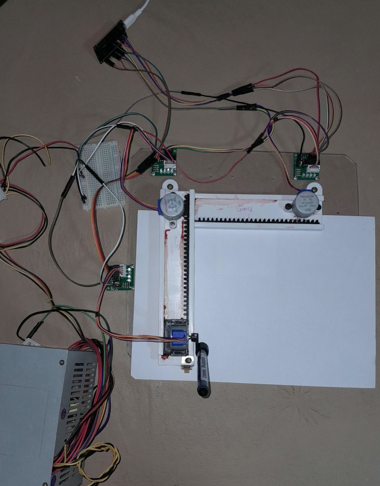
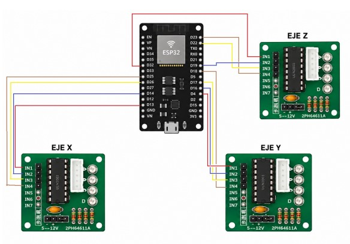
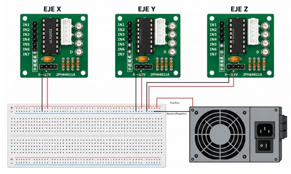
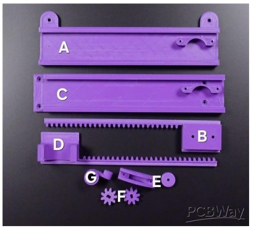

# 📌 UTN FRCU – Tecnologías para la Automatización ESP32 2026
**ESP32-Based 2D CNC Plotter**

## 👥 Team
- **Team number:** 5
- **Members:**
  - Ducret Leturia, Damián Osvaldo
  - Leiva, Octavio
  - Meier, Carlos David
  - Schenberger, Valentina
  - Szajnowicz, Ignacio

---

## 🤖 Project Description

**Description**
Design, development, and implementation of a 2D CNC (Computer Numerical Control) Plotter. The system is capable of interpreting digitally generated coordinates (G-Code) from a computer and translating them into synchronized physical movements in a Cartesian coordinate system (X, Y, Z axes) to plot graphics on a surface using a drawing tool (pen or pencil).

| |
|---|
| |
|General photo of the finished, assembled **CNC Plotter** in operation |

**Applied Theoretical Concepts**
- **Open-Loop Control Systems:** The microcontroller calculates and sends the exact number of steps the motors must take, assuming the action completes successfully without using position sensors to confirm it.
- **Discrete Systems:** Spatial displacement is achieved by sending sequences of exact digital pulses to the stepper motor coils.
- **Exogenous Disturbances:** The system cannot automatically compensate for external errors, such as unintentional paper movement or physical vibrations.

**Technology used**
ESP32, Arduino IDE, C/C++, Arduino libraries (AccelStepper, MultiStepper, WebSocketsServer, ArduinoJson, Preferences), HTML/WebSockets (for the interface), G-Code, Inkscape (vectorization), jscut (G-code generator), UGS (Universal Gcode Sender).

---

## 🔩 Components Used

| Component | Quantity | Notes |
|---|---|---|
| ESP32 DevKit | 1 | Main microcontroller (Operates on 3.3V logic, provides WiFi/Bluetooth connectivity). |
| 28BYJ-48 Stepper Motors | 3 | Spatial actuators (concurrent X, Y axes, and Z axis for the instrument). Operate at 5V. |
| ULN2003 Drivers | 3 | Power drivers (isolation interface between ESP32 signals and motor power). |
| PC ATX Power Supply | 1 | Provides constant 5V power with high amperage for simultaneous motor startup. |
| Breadboard / Jumper Wires | Various | Connections (Dupont) between ESP32, Drivers, and Power Supply. |
| 3D-printed components | Various | Mechanical structure, rails, and pen holder (Parts A, B, C, D, E, F, G). |
| Drawing instrument | 1 | Pencil or ballpoint pen. |

---

## 🛠️ Usage Instructions

### 1. Configurable parameters

| Constant/Variable | Value | Meaning |
|---|---|---|
| `MAX_TRAVEL_XY_MM` | `90` | Safe software limit to prevent mechanical collisions (Clamp). |
| `PEN_UP_Z_MM` | `0.0` | Z-axis position when the instrument is in transit/idle. |
| `PEN_DOWN_Z_MM` | `5.0` | Z-axis position when the instrument is in contact with the paper. |
| `stepsPerMmX/Y` | `47` | Number of steps required to move the motors 1 actual mm on the plane. |

### 2. Build the circuit
| | |
|---|---|
|  | |
|Wiring diagram **Motor Drivers - ESP32**|Wiring diagram **Motor Drivers - Power Supply (__5V__)**|

#### Pin Map

| ESP32 Pin | Connected to | Direction | Constant in code |
|---|---|---|---|
| GPIO 13, 14, 26, 25 | X-Axis Driver (IN1, IN2, IN3, IN4) | Output | `X_IN1`, `X_IN2`, `X_IN3`, `X_IN4` |
| GPIO 4, 16, 17, 18 | Y-Axis Driver (IN1, IN2, IN3, IN4) | Output | `Y_IN1`, `Y_IN2`, `Y_IN3`, `Y_IN4` |
| GPIO 32, 19, 22, 23 | Z-Axis Driver (IN1, IN2, IN3, IN4) | Output | `Z_IN1`, `Z_IN2`, `Z_IN3`, `Z_IN4` |
| VIN (5V) / GND | External Power Supply (ATX) | Power | - |

**Assembly notes:**
1. Connect the external ATX power supply to the breadboard and to the power pins of the ULN2003 drivers.
2. Avoid placing positive lines next to negative lines (horizontally parallel wires) to prevent short circuits.
3. Ensure proper isolation between the power stage (ATX Power Supply + Drivers) and the logic stage (USB-powered ESP32).

### 3. Assembly the circuit

1. Assemble part **A** to the base, with the tabs facing outward from the mount.
2. Attach **B** to **A**, sliding B inside A.
3. On the flat part of **B**, assemble **C** by its curved section.
4. Attach **D** to **C**, sliding D inside B.
5. Mount the gears (**F**) onto the Stepper Motors, and fix them to the curved parts of A and C (the gear must mesh with B and D).
6. Assemble **E** (already assembled with an axle) to C on the free section.
7. Place the third motor with **G** assembled onto part **D**, creating the pen holder.

### 4. Calibrate

This step is mandatory before starting to plot to avoid damaging the physical components:
1. In the **"Calibration"** tab of the web interface, set the Z-Axis to `5 mm`.
2. From the **"Control"** tab, use the arrows to manually move the head to the lower-left corner of the machine.
3. Physically adjust the height of the Z-Axis until the pen tip is **suspended in the air**, very close to the paper but without touching it. 
4. Press the button to set this point as **"Zero (0,0,0)"**. The system assumes that `5 mm` will lower the pen to draw, and `0 mm` will raise it to rest.

### 5. Upload and run

1. Open the `.ino` file located in the `sketch_sep23a` folder in the Arduino IDE, compile, and click **Upload** to the ESP32 board.
2. Reset the microcontroller (disconnect and reconnect the USB cable).
3. Search for the `CNC-Plotter` WiFi network on your PC or mobile phone and enter the password `12345678`.
4. Open the HTML file located inside the `CNC Plotter Web` folder locally in the browser and press the **Connect** button.

### 6. Usage sequence

The system features three drawing modes from the web interface:
- **Control Mode:** Free manual movement using the interface arrows. Allows adjusting the step precision in millimeters.
- **Image Mode:** Uploading line-art images, silhouettes, or logos. The *'Traditional Outline'* method is recommended, adjusting the image to the maximum limit of `90x90 mm` to optimize the motors.
- **Text Mode:** Converting written words into G-Code paths (limit configured to `90 mm`).

⚠️ **Overcurrent Risk (Z-Axis Jam):** If the Z motor loses sync and pushes the pen against the base without being able to move forward, immediately press **Stop** in the web interface to avoid burning out the coils.

---

## 🧪 Simulation

**No Wokwi simulation was performed.** As it involves a complex mechanical assembly coordinating physical paths with 3D-printed parts and empirical torque adjustments, the project is entirely focused on and validated through its physical hardware implementation.

---

## 📝 Additional Notes

### Challenges faced
- **Torque loss on X-Axis:** A loose contact in a Dupont cable prevented the activation of the motor's second coil, causing a lack of torque. This was resolved by replacing the cable.
- **Z-Axis inversion:** The motor raised the pen when instructed to lower it. This was resolved in software by inverting the logical limit references.
- **Geometric scale desynchronization:** A 47 mm travel in software exhausted the 100 physical mm. The steps per millimeter variable (`stepsPerMm`) was recalculated, adjusting it from 100 to 47 to restore absolute accuracy.
- **Collision prevention:** Lacking limit switches (endstops), the predictive function `clampTravel()` was created in firmware to limit the maximum travel via software.

### Technical decisions
- **Asynchronous Actuator Management:** Use of `AccelStepper` in `FULL4WIRE` mode and `MultiStepper` to calculate relative speeds, ensuring perfect diagonal strokes.
- **Command Queue (Buffer):** Implementation of a dynamic queue (`std::deque`) to enqueue JSON commands via WebSocket, preventing ESP32 saturation and buffer underflow.
- **Persistent Memory (NVS):** The `Preferences.h` library periodically saves current coordinates so the plotter can resume its reference system without losing calibration during unexpected power outages.

### Potential improvements

1. **Analog joystick (Manual control):** To enable freehand movement by reading voltage variations, without requiring precalculated G-Code.
2. **Interrupt button (Abort drawing):** A physical push button with hardware interrupts for instant emergency stop.
3. **Limit switches (Endstops):** Mechanical switches at the ends of the X and Y axes to enable homing and mechanical self-calibration at system startup.
