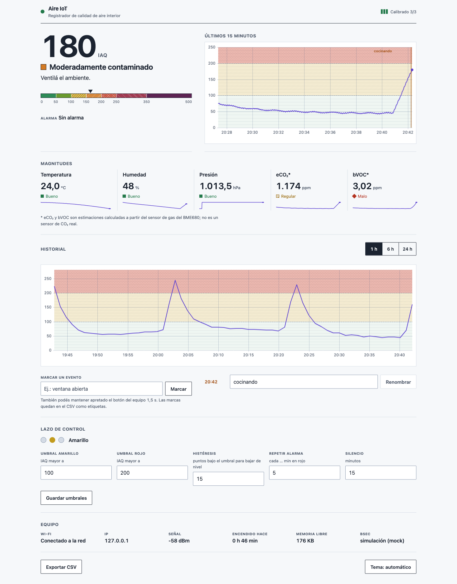

# Aire IoT — Monitor de calidad de aire interior (ESP32 + BME680)

Trabajo Práctico Integrador · UTN FRCU · Tecnologías para la Automatización (track Microcontroladores).

**Integrantes:** Slootmans, Maria · Nuñez Baccón, Victoria · Valli, Franco Ignacio

> 📄 **Informe de la Etapa 1:** [docs/informe_etapa1.md](docs/informe_etapa1.md) (versión editable en Word: `docs/informe_etapa1.docx`).

Un ESP32 lee un sensor Bosch **BME680**, procesa la señal con la librería oficial **BSEC2** y calcula un **índice de calidad de aire (IAQ 0–500)**, CO₂ equivalente, VOC equivalente, temperatura, humedad y presión. Con esos datos:

- enciende un **LED verde, amarillo o rojo** según el nivel, con **histéresis** para que no parpadee;
- hace sonar un **buzzer** cuando el aire está mal, y un **pulsador** permite silenciarlo o marcar eventos;
- sirve un **dashboard web** desde su propia memoria flash, que funciona **sin internet**, desde el celular;
- guarda **24 h de historial** y lo exporta en **CSV** (el dataset para una fase posterior de Machine Learning).

## ¿Para qué sirve?

En un aula, una oficina o una cocina, el aire se "carga" sin que lo notemos: CO₂ de la respiración, vapores de limpieza, humo de cocina. Eso baja la concentración y puede afectar la salud. El equipo avisa **cuándo conviene ventilar** y muestra cómo se recupera el ambiente cuando lo hacemos, con un costo de materiales de unos pocos dólares.



---

## Materiales

| Componente | Especificaciones clave | Cómo se usa acá |
|---|---|---|
| **ESP32 DevKit V1** (ESP32-WROOM-32, 30 o 38 pines) | Doble núcleo 240 MHz, 520 KB SRAM, 4 MB flash, Wi-Fi 2,4 GHz, lógica de **3,3 V** (¡no tolera 5 V en los GPIO!) | Microcontrolador, servidor web y punto de acceso Wi-Fi |
| **BME680** (breakout) | Alimentación 1,7–3,6 V (usar **3V3**); interfaz **I2C** (0x76 o 0x77) o SPI; mide temperatura, humedad, presión y resistencia de gas (placa calefactora interna); modo forzado | Sensor, por I2C, muestreado cada 3 s (modo LP de BSEC) |
| 3 LEDs (verde, amarillo, rojo) + 3 resistencias de **220–330 Ω** | ~2 V de caída, ~5 mA con 330 Ω a 3,3 V | Indicador de nivel (actuador visual) |
| **KY-006** buzzer **pasivo** | Necesita una **señal alternada** (PWM/tono) para sonar: con un nivel fijo no suena | Alarma sonora (tono generado con el periférico LEDC del ESP32) |
| Pulsador | Normal abierto | A GND, con la resistencia *pull-up* interna del ESP32 |
| Protoboard, cables, cable USB de datos | — | — |

Conexionado detallado y armado agujero por agujero en la protoboard: [docs/conexion.md](docs/conexion.md).

---

## Versiones probadas

El proyecto se compiló con estas versiones exactas. Usá las mismas; con otras puede funcionar, pero no está verificado.

| Qué | Versión |
|---|---|
| Arduino IDE | 2.x |
| Core **esp32** de Espressif (Gestor de placas) | **3.3.12** |
| **bsec2** (Bosch Sensortec) | **1.10.2610** |
| **BME68x Sensor library** (Bosch Sensortec) | **1.3.40408** |
| **ESP Async WebServer** (de *ESP32Async*) | **3.12.1** |
| **Async TCP** (de *ESP32Async*) | **3.5.0** |
| **ArduinoJson** (Benoit Blanchon) | **7.4.3** |
| uPlot (ya incluido en `web/`, no se instala) | 1.6.32 |

Uso de recursos medido al compilar: **1.161.816 B de flash (88 %)** y **100.624 B de RAM global (30 %)**; la página web completa pesa **35,2 KB** comprimida.

> ⚠️ Hay varias librerías llamadas "AsyncWebServer" y "AsyncTCP". Instalá las del autor **ESP32Async** (las mantenidas, compatibles con el core 3.x).

---

## Instalación paso a paso (Arduino IDE 2)

1. **Core del ESP32**
   1. *Archivo → Preferencias → URLs adicionales de gestores de placas*, agregá:
      `https://espressif.github.io/arduino-esp32/package_esp32_index.json`
   2. *Herramientas → Placa → Gestor de placas*, buscá **esp32** (de Espressif Systems) e instalá la versión **3.3.12**.
2. **Librerías**: en *Herramientas → Administrar bibliotecas* instalá, con la versión exacta de la tabla:
   `bsec2` (si pregunta, elegí **Instalar todo** para que también instale *BME68x Sensor library*), `ESP Async WebServer`, `Async TCP` y `ArduinoJson`.
3. **Abrí el sketch**: `firmware/aire_iot/aire_iot.ino`. El IDE abre todos los módulos como pestañas.
4. **Tu Wi-Fi**: copiá `firmware/aire_iot/secrets.example.h` como `firmware/aire_iot/secrets.h` y completá `WIFI_SSID` y `WIFI_PASS`. (`secrets.h` no se sube al repositorio). Si no tenés red, dejalo como está: el equipo creará la suya.
5. **Placa**: *Herramientas → Placa → esp32 → **ESP32 Dev Module***. Elegí el puerto USB. El esquema de particiones por defecto alcanza.
6. **Subir** (flecha →). Si queda en "Connecting…", mantené apretado el botón **BOOT** de la placa hasta que empiece a escribir. Si falla con *"Unable to verify flash chip connection"*, bajá *Herramientas → Upload Speed* a **115200** (pasa con varios adaptadores USB-serie; en nuestra placa hizo falta).
7. Abrí el **Monitor serie a 115200 baudios**: vas a ver la IP y una línea CSV cada ~3 s.

### Primer uso: probá el sensor antes

Antes del firmware completo, subí `tools/i2c_scanner/i2c_scanner.ino`. En el monitor serie tiene que aparecer **0x76** (SDO a GND) o **0x77** (SDO a 3V3). Si aparece 0x77, cambiá `BME680_ADDR` en `firmware/aire_iot/config.h`.

### Abrir el dashboard

- **Con tu Wi-Fi:** entrá a `http://aire.local` o a la IP que muestra el monitor serie, desde un dispositivo en la misma red.
- **Sin Wi-Fi (modo AP):** si no conecta en 15 s, el ESP32 crea la red **`AireIoT`** con clave **`aire1234`**. Conectá el celular a esa red y abrí **`http://192.168.4.1`**.

---

## Uso

| Acción | Resultado |
|---|---|
| El IAQ supera 100 / 200 | LED amarillo / rojo. Al entrar en rojo suenan 3 beeps, que se repiten cada 30 s mientras siga en rojo (configurable de 5 a 600 s) |
| Pulsación **corta** (< 1 s) o "Silenciar alarma" en la web | Silencia la alarma 15 min |
| Pulsación **larga** (≥ 1,5 s) | Guarda un **marcador de evento** (beep corto). En la web lo podés renombrar ("cocinando", "ventana abierta") |
| "Exportar CSV" | Descarga las últimas 24 h con los marcadores en la columna `evento` |
| Editor de umbrales | Cambia umbrales, histéresis y tiempos. Se guardan en la memoria no volátil del ESP32 |

**Calibración:** BSEC necesita tiempo para calibrarse. La web muestra la *precisión* 0–3. Con 0–1 el IAQ **no es confiable** y el buzzer no suena. El estado de calibración se guarda cuando llega a 3 y después cada 4 h, así que sobrevive a los reinicios.

**eCO₂ y bVOC son estimaciones** que BSEC calcula a partir del sensor de gas; el BME680 **no** mide CO₂ real.

---

## Modificar la página web

Los archivos de la página están en `web/`. El firmware no los lee directamente, sino una copia comprimida en `firmware/aire_iot/web_assets.h`. Después de editar `web/`:

```bash
python3 tools/build_web.py           # regenera web_assets.h
python3 tools/build_web.py --check   # verifica que esté al día (útil antes de entregar)
```

Solo hace falta Python 3; no usa librerías externas.

### Probar la web sin el ESP32 (mock)

```bash
python3 -m pip install -r tools/requirements.txt
python3 tools/mock_server.py --rapido       # http://localhost:8080, el tiempo corre 10× más rápido
python3 tools/mock_server.py --selftest     # verifica que el generador coincida con el del firmware
```

## Modo simulación (sin sensor)

En `firmware/aire_iot/config.h`, descomentá `#define SIMULATION`. El firmware reemplaza el BME680 por datos sintéticos, con un ciclo de 20 min: aire limpio, pico de contaminación y recuperación al ventilar. Sirve para desarrollar, para una demo de respaldo o si el sensor falla en la presentación. Todo lo demás (LEDs, buzzer, web) funciona igual.

## Tests

La lógica de control y el formato de datos no dependen de Arduino, así que se prueban en la PC:

```bash
mkdir -p build
g++ -std=c++17 -Wall -Wextra -I firmware/aire_iot tools/test_nativo.cpp \
    firmware/aire_iot/control.cpp firmware/aire_iot/muestras.cpp -o build/test_nativo && build/test_nativo
```

---

## Problemas frecuentes

**El escáner I2C no encuentra nada / "Sensor no detectado".**
- Revisá SDA → GPIO 21, SCL → GPIO 22, VCC → **3V3** (no 5 V) y GND.
- **CS debe ir a 3V3**; si queda al aire, el sensor puede arrancar en modo SPI.
- SDO define la dirección: a GND es 0x76, a 3V3 es 0x77. Tiene que coincidir con `BME680_ADDR` en `config.h`.
- Con sensor caído, los 3 LEDs parpadean juntos, la web muestra "Sensor no detectado" y el equipo reintenta cada 10 s. Cuando vuelve el contacto, se recupera solo.
- Un **falso contacto** en la protoboard da exactamente estos síntomas: apretá bien los cables del sensor.

**La precisión de BSEC queda en 0.** Es normal los primeros minutos. BSEC calibra comparando el aire "limpio" con el "sucio": dejalo andando (idealmente horas) y exponelo alguna vez a aire fresco (ventana) y a un estímulo (aliento, alcohol en gel cerca). La configuración usada tiene una ventana de calibración de 4 días. El estado se guarda recién al llegar a 3.

**Siempre arranca en modo AP (`AireIoT`).** Revisá `secrets.h`: SSID y clave exactos, y que la red sea de **2,4 GHz** (el ESP32 no ve redes de 5 GHz). Las redes con portal cautivo (típicas de facultades) no funcionan; usá el modo AP o el hotspot del celular.

**`aire.local` no abre.** Algunos Android no resuelven mDNS: usá la IP que muestra el monitor serie (o `192.168.4.1` en modo AP).

**La subida falla con "Unable to verify flash chip connection" o "No more data to read".** Bajá *Upload Speed* a 115200 y usá un cable USB de datos corto.

**Error de compilación `Falta secrets.h`.** Copiá `secrets.example.h` como `secrets.h` (paso 4).

**La temperatura da 1–2 °C de más.** El sensor y la placa se calientan. Ajustá `TEMP_OFFSET_C` en `config.h` comparando con un termómetro.

---

## Documentación

- [docs/informe_etapa1.md](docs/informe_etapa1.md): informe de la Etapa 1 (justificación, componentes, conceptos y riesgos).
- [docs/codigo.md](docs/codigo.md): guía del código fuente: en qué orden leerlo y dónde tocar.
- [docs/conexion.md](docs/conexion.md): conexionado, esquema y armado en la protoboard.
- [docs/arquitectura.md](docs/arquitectura.md): bloques, flujo de datos y máquinas de estado.
- [docs/conceptos_teoricos.md](docs/conceptos_teoricos.md): realimentación, histéresis y perturbaciones en este sistema.
- [docs/mejora_propuesta.md](docs/mejora_propuesta.md): etapa 2, cerrar el lazo con un extractor.
- [docs/complicaciones.md](docs/complicaciones.md): problemas encontrados y cómo se resolvieron.

## Estructura

```
firmware/aire_iot/   sketch de Arduino (config, control, sensor, muestras, storage, actuators, web)
web/                 fuentes del dashboard (HTML/CSS/JS + uPlot)
tools/               escáner I2C, build_web.py, mock_server.py, tests nativos
docs/                documentación
```
