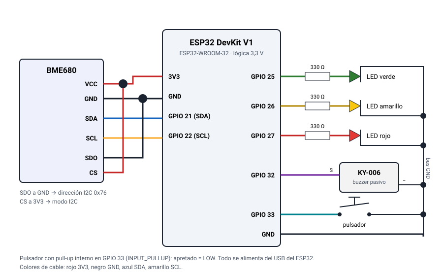

# 📌 UTN FRCU – Tecnologías para la Automatización ESP32 2026

**Aire IoT — Indoor air quality monitor (ESP32 + BME680)**

---

## 👥 Team
- **Team number:** 9
- **Members:**
  - Slootmans, Maria
  - Nuñez Baccón, Victoria
  - Valli, Franco Ignacio

---

## 🤖 Project Description
- **Description:**

An ESP32 reads a Bosch **BME680** sensor, processes the signal with Bosch's official **BSEC2** library and computes an **indoor air quality index (IAQ 0–500)**, equivalent CO₂, equivalent VOC, temperature, humidity and pressure. With that data it:

- lights a **green, yellow or red LED** depending on the level, with **hysteresis** so it does not flicker at the thresholds;
- sounds a **buzzer** when the air is bad, and a **push button** silences it or records event markers;
- serves a **web dashboard** from its own flash memory that works **without internet**, from a phone;
- keeps **24 h of history** and exports it as **CSV** (the dataset for a later Machine Learning stage).

In a classroom, an office or a kitchen the air gets "loaded" without us noticing: CO₂ from breathing, cleaning vapors, cooking smoke. That lowers concentration and can affect health. The device tells **when to ventilate** and shows how the room recovers after doing so, for a few dollars in parts.


- **Technology used:**

ESP32 (Espressif Arduino core 3.3.12), Arduino IDE 2.x, C++, Bosch BSEC2, ESP Async WebServer + WebSocket, ArduinoJson, HTML/CSS/JS dashboard with uPlot, Python 3 (build script and mock server).

---

## 🔩 Components Used
| Component | Quantity | Notes |
|---|---|---|
| ESP32 DevKit V1 | 1 | ESP32-WROOM-32 (30 or 38 pins). Dual core 240 MHz, 520 KB SRAM, 4 MB flash, 2.4 GHz Wi-Fi. **3.3 V logic** (GPIOs are not 5 V tolerant). Microcontroller, web server and Wi-Fi access point. |
| BME680 breakout | 1 | Supply 1.7–3.6 V (use **3V3**), **I2C** at 0x76 (SDO to GND) or 0x77. Measures temperature, humidity, pressure and gas resistance. Sampled every 3 s (BSEC LP mode). |
| LEDs (green, yellow, red) | 3 | Air level indicator. ~2 V drop, ~4 mA each. |
| 220–330 Ω resistors | 3 | In series with each LED. |
| KY-006 **passive** buzzer | 1 | Needs an alternating signal: the tone is generated with the ESP32's LEDC (PWM) peripheral. A fixed level does not make it sound. |
| Push button | 1 | Normally open, to GND, using the ESP32's internal pull-up. Software debounce (30 ms). |
| Breadboard / Jumper wires | 1 / ~15 | 400-point breadboard. Keep the sensor wires short (< 20 cm). |
| Power supply | 1 | USB data cable (5 V from the computer or a phone charger). |

### Wiring

Pins are defined in a single place: `firmware/aire_iot/config.h`.

| Signal | ESP32 pin |
|---|---|
| BME680 VCC / GND | **3V3** / GND (never 5 V) |
| BME680 SDA / SCL | **GPIO 21** / **GPIO 22** (default I2C) |
| BME680 SDO | GND → address **0x76** |
| BME680 CS | **3V3** (keeps the sensor in I2C mode) |
| LED green / yellow / red (330 Ω in series) | **GPIO 25** / **GPIO 26** / **GPIO 27** |
| KY-006 S / − | **GPIO 32** / GND |
| Push button | **GPIO 33** ↔ GND |

All these pins exist on both the 30- and 38-pin boards. GPIO 6–11 (internal flash) and the strapping pins (0, 2, 5, 12, 15) are avoided on purpose.



Full wiring and hole-by-hole breadboard layout (Spanish): [docs/conexion.md](docs/conexion.md).

---

## 🛠️ Usage Instructions

### Tested versions

| What | Version |
|---|---|
| Arduino IDE | 2.x |
| Espressif **esp32** core (Boards Manager) | **3.3.12** |
| **bsec2** (Bosch Sensortec) | **1.10.2610** |
| **BME68x Sensor library** (Bosch Sensortec) | **1.3.40408** |
| **ESP Async WebServer** (by *ESP32Async*) | **3.12.1** |
| **Async TCP** (by *ESP32Async*) | **3.5.0** |
| **ArduinoJson** (Benoit Blanchon) | **7.4.3** |
| uPlot (bundled in `web/`, not installed) | 1.6.32 |

Measured at compile time: **1,161,816 B of flash (88 %)** and **100,624 B of global RAM (30 %)**. The whole web page weighs **35.2 KB** compressed.

> ⚠️ There are several libraries named "AsyncWebServer" and "AsyncTCP". Install the ones by **ESP32Async** (maintained and compatible with core 3.x).

1. **Install the environment**
   1. In *File → Preferences → Additional boards manager URLs* add:
      `https://espressif.github.io/arduino-esp32/package_esp32_index.json`
   2. In *Tools → Board → Boards Manager* search for **esp32** (Espressif Systems) and install version **3.3.12**.
   3. In *Tools → Manage Libraries* install the exact versions from the table: `bsec2` (choose **Install all** so it also installs *BME68x Sensor library*), `ESP Async WebServer`, `Async TCP` and `ArduinoJson`.
2. **Wire the circuit** following the table above. Before the full firmware, upload `tools/i2c_scanner/i2c_scanner.ino`: the serial monitor must show **0x76** (SDO to GND) or **0x77** (SDO to 3V3). If it shows 0x77, change `BME680_ADDR` in `firmware/aire_iot/config.h`.
3. **Upload the sketch**
   1. Open `firmware/aire_iot/aire_iot.ino` (the IDE opens every module as a tab).
   2. Copy `firmware/aire_iot/secrets.example.h` to `firmware/aire_iot/secrets.h` and fill in `WIFI_SSID` and `WIFI_PASS` (`secrets.h` is git-ignored). Without a network, leave it as is: the device creates its own.
   3. Select *Tools → Board → esp32 → **ESP32 Dev Module*** and the USB port. The default partition scheme is enough.
   4. Upload. If it hangs on "Connecting…", hold the **BOOT** button. If it fails with *"Unable to verify flash chip connection"*, lower *Tools → Upload Speed* to **115200**.
4. **Expected output**
   - The **serial monitor at 115200 baud** shows the IP and one CSV line every ~3 s.
   - **With your Wi-Fi:** open `http://aire.local` or the IP shown in the serial monitor, from a device on the same network.
   - **Without Wi-Fi (AP mode):** if it cannot connect within 15 s, the ESP32 creates the **`AireIoT`** network, password **`aire1234`**. Connect your phone and open **`http://192.168.4.1`**.

### Operation

| Action | Result |
|---|---|
| IAQ goes above 100 / 200 | Yellow / red LED. Entering red plays 3 beeps, repeated every 30 s while it stays red (configurable 5–600 s) |
| **Short** press (< 1 s) or "Silenciar alarma" on the web | Silences the alarm for 15 min |
| **Long** press (≥ 1.5 s) | Saves an **event marker** (short beep). It can be renamed on the web ("cooking", "window open") |
| "Exportar CSV" | Downloads the last 24 h, with markers in the `evento` column |
| Threshold editor | Changes thresholds, hysteresis and timings. Stored in the ESP32's non-volatile memory |

**Calibration:** BSEC needs time to calibrate. The web shows the *accuracy* 0–3. With 0–1 the IAQ is **not reliable** and the buzzer stays quiet. The calibration state is saved when it reaches 3 and then every 4 h, so it survives reboots.

**eCO₂ and bVOC are estimates** that BSEC derives from the gas sensor; the BME680 does **not** measure real CO₂.

### Editing the web page

The page sources are in `web/`. The firmware serves a compressed copy in `firmware/aire_iot/web_assets.h`. After editing `web/`:

```bash
python3 tools/build_web.py           # regenerates web_assets.h
python3 tools/build_web.py --check   # checks it is up to date
```

### Tests

The control logic and the data format do not depend on Arduino, so they run on a PC:

```bash
mkdir -p build
g++ -std=c++17 -Wall -Wextra -I firmware/aire_iot tools/test_nativo.cpp \
    firmware/aire_iot/control.cpp firmware/aire_iot/muestras.cpp -o build/test_nativo && build/test_nativo
```

---

## 🧪 Simulation
- **Wokwi:** not available: Wokwi has no BME680 part, so the project was tested on the physical build.
- **Firmware simulation mode:** uncomment `#define SIMULATION` in `firmware/aire_iot/config.h`. The firmware replaces the BME680 with synthetic data on a 20-minute cycle (clean air, pollution peak, recovery after ventilating). LEDs, buzzer and web work exactly the same. Useful for development or as a backup demo.
- **Web without the ESP32 (mock server):**
  ```bash
  python3 -m pip install -r tools/requirements.txt
  python3 tools/mock_server.py --rapido     # http://localhost:8080, time runs 10× faster
  python3 tools/mock_server.py --selftest   # checks the generator matches the firmware's
  ```
- Diagram/export files: `docs/conexion.svg` (schematic) and `docs/protoboard.svg` (breadboard layout).

---

## 📝 Additional Notes

### Troubleshooting

- **I2C scanner finds nothing / "Sensor no detectado":** check SDA → GPIO 21, SCL → GPIO 22, VCC → **3V3**, GND, and **CS to 3V3** (left floating, the sensor may start in SPI mode). SDO must match `BME680_ADDR`. With the sensor down, the 3 LEDs blink together, the web shows "Sensor no detectado" and the device retries every 10 s, recovering on its own. A loose breadboard contact gives exactly these symptoms.
- **BSEC accuracy stays at 0:** normal for the first minutes. Leave it running (ideally hours) and expose it once to fresh air (window) and to a stimulus (breath, hand sanitizer nearby). The configuration has a 4-day calibration window.
- **Always starts in AP mode:** check `secrets.h` (exact SSID and password) and that the network is **2.4 GHz**. Captive-portal networks (common at universities) do not work; use AP mode or a phone hotspot.
- **`aire.local` does not open:** some Android phones do not resolve mDNS; use the IP from the serial monitor.
- **Compile error `Falta secrets.h`:** copy `secrets.example.h` to `secrets.h`.
- **Temperature reads 1–2 °C high:** the sensor and board warm up. Adjust `TEMP_OFFSET_C` in `config.h` against a thermometer.

### Challenges, limitations and improvements

- Challenges faced and how they were solved: [docs/complicaciones.md](docs/complicaciones.md).
- The system is open loop: it warns, but a person has to ventilate. The proposed Stage 2 closes the loop by driving an extractor fan: [docs/mejora_propuesta.md](docs/mejora_propuesta.md).
- eCO₂/bVOC are estimates, and IAQ is only reliable once BSEC reaches accuracy 2–3.

### Documentation (Spanish)

- [docs/informe_etapa1.md](docs/informe_etapa1.md): Stage 1 report (rationale, components, concepts and risks). Word version: `docs/informe_etapa1.docx`.
- [docs/codigo.md](docs/codigo.md): source code guide, reading order and where to make changes.
- [docs/conexion.md](docs/conexion.md): wiring, schematic and breadboard layout.
- [docs/arquitectura.md](docs/arquitectura.md): blocks, data flow and state machines.
- [docs/conceptos_teoricos.md](docs/conceptos_teoricos.md): feedback, hysteresis and disturbances in this system.

### Structure

```
firmware/aire_iot/   Arduino sketch (config, control, sensor, muestras, storage, actuators, web)
web/                 dashboard sources (HTML/CSS/JS + uPlot)
tools/               I2C scanner, build_web.py, mock_server.py, native tests
docs/                documentation
```
