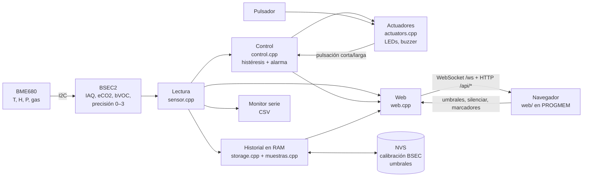
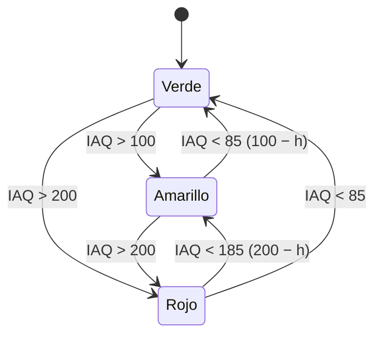
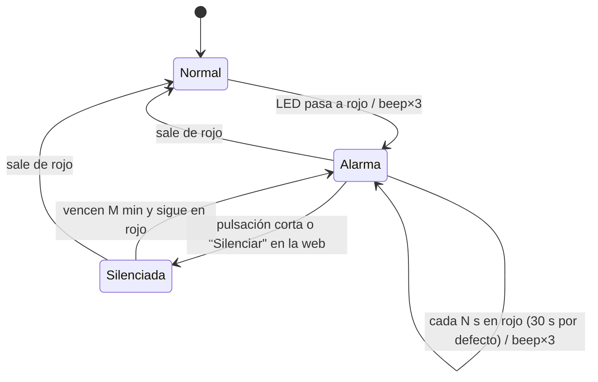
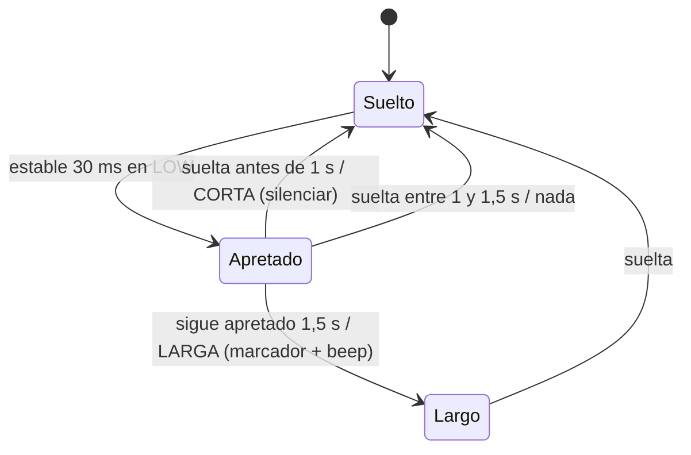

# Arquitectura

## Diagrama de bloques

Con `SIMULATION` definido, el bloque BME680 + BSEC2 se reemplaza por `simular()` (en `sensor.h`) y el resto no cambia.

## Módulos

| Archivo | Qué hace | Depende de Arduino |
|---|---|---|
| `config.h` | Pines, dirección I2C, tiempos, `struct Config` con los umbrales por defecto. **Único lugar a tocar para adaptar el hardware.** | No |
| `control.h/.cpp` | Bandas Bosch, LED con histéresis, máquina de estados de la alarma, clasificación del pulsador, validación de la config. Es el "controlador". | No (se testea en la PC) |
| `sensor.h/.cpp` | `struct Lectura`, generador sintético `simular()`, integración con BSEC2 (config `bme680_iaq_33v_3s_4d`) y guardado de la calibración. | Sí (salvo `sensor.h`) |
| `muestras.h/.cpp` | Muestra compacta de 24 B, buffer circular `Anillo`, promedio por minuto, formato CSV, marcadores. | No (se testea en la PC) |
| `storage.h/.cpp` | Buffers globales (24 h, 15 min, 64 marcadores), NVS con `Preferences`, lock entre tareas. | Sí |
| `actuators.h/.cpp` | LEDs, secuenciador de notas del buzzer (LEDC) y lectura del pulsador. | Sí |
| `web.h/.cpp` | Wi-Fi (estación → AP), mDNS `aire.local`, NTP, servidor HTTP asíncrono, WebSocket, CSV en streaming. | Sí |
| `web_assets.h` | La página web comprimida (generada por `tools/build_web.py`). | — |

## Flujo de datos por muestra

`loop()` (en `aire_iot.ino`) no se bloquea nunca: cada vuelta le da un turno corto a cada módulo. Cuando `sensorActualizar()` entrega una lectura nueva (cada 3 s):

1. **Control:** `controlPaso()` actualiza el estado del LED (con histéresis) y la máquina de alarma. Si corresponde, suena `buzzerAlarma()`.
2. **Registro:** `storageAgregar()` guarda la muestra en el buffer en vivo (15 min) y la acumula en el promedio del minuto. Cada 60 s el promedio pasa al historial de 24 h. Se imprime una línea CSV por el puerto serie.
3. **Publicación:** `webPublicar()` envía la lectura por WebSocket a todos los navegadores conectados.

Además, en cada vuelta: el pulsador (`botonLeer()`), los pedidos de la web (silenciar), el refresco de LEDs y buzzer (`actuadoresActualizar()`) y el mantenimiento del Wi-Fi (`webActualizar()`).

### Concurrencia

El servidor web asíncrono atiende los pedidos en **otra tarea de FreeRTOS**, no en `loop()`. Por eso:

- todo acceso a los buffers, a los marcadores o a `config` desde la web va entre `storageBloquear()` y `storageDesbloquear()` (una sección crítica corta);
- los pedidos que cambian el lazo (silenciar) se pasan con una bandera que `loop()` atiende en su próxima vuelta;
- el CSV se genera **fila por fila** mientras el navegador lo descarga: nunca se arma entero en RAM.

## Máquinas de estado

### LED (nivel) con histéresis

`siguienteLed()` en `control.cpp`. Con los valores por defecto (umbrales 100 y 200, h = 15):

### Alarma

`controlPaso()` y `controlSilenciar()` en `control.cpp`.

Con precisión BSEC 0–1 el estado cambia igual, pero **no se emite sonido** hasta que la precisión llega a 2.

### Pulsador

`botonPaso()` en `control.cpp`: antirrebote de 30 ms, luego se clasifica por duración.

## Almacenamiento

| Qué | Dónde | Tamaño |
|---|---|---|
| Últimos 15 min (1 muestra cada 3 s) | RAM, `vivo` | 300 × 24 B ≈ 7 KB |
| Últimas 24 h (promedio por minuto) | RAM, `historial` | 1440 × 24 B ≈ 34 KB |
| Marcadores de eventos | RAM, `marcadores` | 64 × 32 B ≈ 2 KB |
| Calibración BSEC (238 B) y umbrales | NVS (flash) | — |

Al arrancar, el firmware imprime el tamaño real de los buffers y el heap libre. El historial **se pierde al reiniciar**: exportá el CSV antes de desenchufar.

Cada `Muestra` guarda enteros escalados (por ejemplo, `temp100` = °C × 100) para que 24 h entren en la RAM.

### Columnas del CSV

`uptime_s, epoch, iaq, siaq, acc, eco2, bvoc, temp, hum, pres, gas, led, evento`

- `uptime_s`: segundos desde el arranque del equipo.
- `epoch`: hora Unix, **vacía si no hubo NTP** (por ejemplo, en modo AP).
- `acc`: precisión BSEC 0–3.
- `led`: 0 verde, 1 amarillo, 2 rojo.
- `evento`: etiqueta del marcador que cae en esa fila.

## Generador sintético (simulación)

Implementado **igual** en `firmware/aire_iot/sensor.h` (`simular()`) y en `tools/mock_server.py` (`simular()`). Si cambiás uno, cambiá el otro y los valores de referencia de los dos tests. Con `t` en segundos y un ciclo de 20 min, `p = t mod 1200`:

- **pico** (cocinar, luego ventilar): 0 si p < 300; sube lineal hasta 180 entre 300 y 420 s; después decae como 180·e^(−(p−420)/120), con **τ = 120 s**.
- **IAQ** = 60 + 15·sen(2πt/3600) + pico + 3·sen(1,7t)·sen(0,31t), recortado a 0–500.
- IAQ estático = 0,95·IAQ; **eCO₂** = 400 + 5·max(IAQ − 25, 0) ppm; **bVOC** = 0,5·e^(IAQ/100) ppm.
- Temperatura = 23 + 1,5·sen(2πt/7200) °C; humedad = 45 + 5·sen(2πt/5400) + 0,03·pico %; presión = 1013 + 0,5·sen(2πt/10800) hPa; gas = 150000·e^(−IAQ/150) Ω.
- **Precisión**: 0 (< 120 s), 1 (< 300 s), 2 (< 600 s) y después 3.

## Red

1. Arranca en **modo estación** con las credenciales de `secrets.h`.
2. Si en 15 s no conecta, pasa a **modo punto de acceso**: red `AireIoT`, clave `aire1234`, IP `192.168.4.1`.
3. En los dos casos publica `aire.local` por mDNS.
4. En modo estación pide la hora por NTP (UTC−3); con ella se completa la columna `epoch`.

| Ruta | Método | Respuesta |
|---|---|---|
| `/` | GET | Dashboard (gzip) |
| `/ws` | WebSocket | JSON por muestra: `t, iaq, siaq, acc, eco2, bvoc, temp, hum, pres, gas, nivel, led, alarma, sensor_ok` |
| `/api/current` | GET | Última muestra + `equipo` (modo, ip, rssi, uptime, heap, bsec, epoch_arranque) |
| `/api/history?range=live\|1h\|6h\|24h` | GET | CSV |
| `/api/export.csv` | GET | CSV de 24 h como descarga |
| `/api/markers` | GET | `[{id, t, label}]` |
| `/api/marker` | POST | `{label}` crea, `{id, label}` renombra |
| `/api/config` | GET/POST | `umbral_amarillo, umbral_rojo, histeresis, repetir_seg, silencio_min` (400 con mensaje si no es válida) |
| `/api/silence` | POST | Silencia la alarma |
