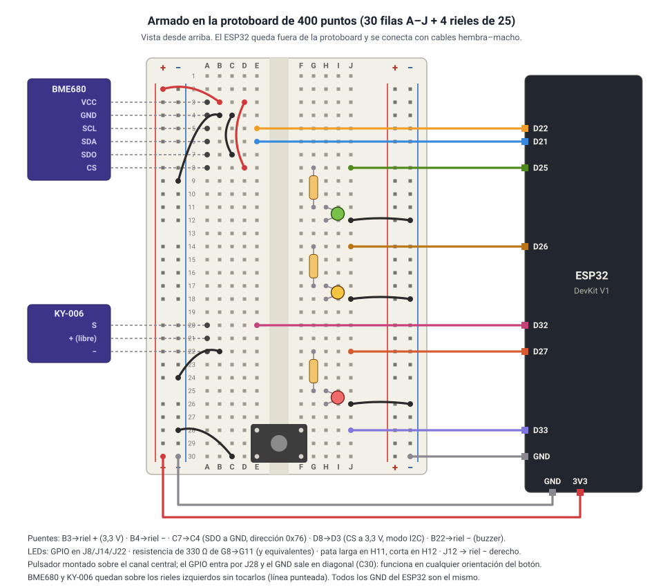
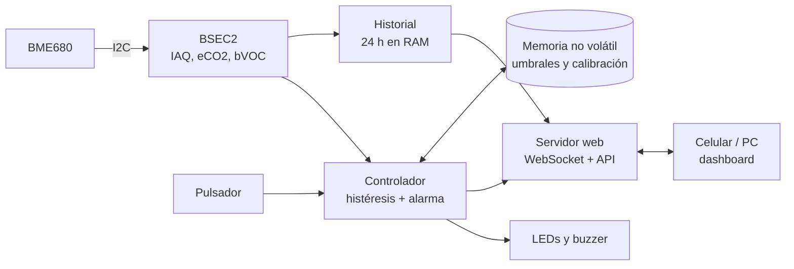

# Aire IoT: monitor de calidad de aire interior con ESP32 y BME680

**Trabajo Práctico Integrador · Etapa 1 · Microcontroladores**

| | |
|---|---|
| **Universidad** | UTN – Facultad Regional Concepción del Uruguay |
| **Carrera** | Ingeniería en Sistemas de Información |
| **Materia** | Tecnologías para la Automatización (2026) |
| **Disciplina elegida** | Microcontroladores (ESP32 / Arduino) |
| **Integrantes** | Slootmans, Maria · Nuñez Baccón, Victoria · Valli, Franco Ignacio |
| **Entrega** | 30/09/2026 |

---

## 1. Resumen

Construimos un equipo que **mide la calidad del aire de un ambiente cerrado y avisa cuándo hay que ventilar**. Un ESP32 lee un sensor Bosch BME680 cada 3 segundos y lo procesa con la librería oficial de Bosch (BSEC2). Así obtiene un **índice de calidad de aire (IAQ, de 0 a 500)**, CO₂ y compuestos orgánicos volátiles (VOC) estimados, temperatura, humedad y presión.

Con esa medición, un controlador con **histéresis** enciende un LED verde, amarillo o rojo. Si el aire empeora, suena un **buzzer**, y un **pulsador** permite silenciarlo o marcar eventos. El ESP32 además sirve un **dashboard web** desde su propia memoria: se abre desde el celular, no necesita internet y muestra gráficos en vivo, 24 h de historial y la exportación de los datos a CSV.


---

## 2. Definición del proyecto

### 2.1 Problema

En un aula, una oficina o una cocina, el aire se "carga" sin que nadie lo note: CO₂ y VOC de la respiración, vapores de productos de limpieza, humo y gases de la cocción. Una mala calidad de aire interior se asocia con cansancio, dolor de cabeza y menor concentración. La solución es simple, ventilar, pero el problema es **saber cuándo**: los sentidos se acostumbran rápido y no detectan el deterioro gradual.

### 2.2 Propuesta

Un dispositivo de bajo costo que:

1. **mide** de forma continua la calidad del aire (sensor BME680 + algoritmo BSEC2 de Bosch);
2. **decide** si el aire está bien, regular o mal, con umbrales configurables e histéresis;
3. **actúa** sobre el entorno avisando a las personas: LED de color visible a distancia, alarma sonora repetitiva y un dashboard con recomendaciones ("Ventilá el ambiente");
4. **registra** la evolución para ver cómo se recupera el ambiente al ventilar y para usar los datos más adelante (por ejemplo, para entrenar un modelo de Machine Learning).

### 2.3 Por qué es útil (aplicación real)

- **Aulas y oficinas:** avisa cuándo abrir las ventanas sin depender de la percepción de las personas, que se acostumbran al aire viciado.
- **Cocinas y talleres:** detecta picos de VOC (cocción, solventes, limpieza) y muestra cuánto tarda el ambiente en recuperarse.
- **Costo:** los equipos comerciales de este tipo (Airthings, Awair, uHoo) cuestan cientos de dólares. Este usa componentes de pocos dólares, no necesita nube ni suscripción y sus datos son del usuario.
- **Base para crecer:** hoy avisa a una persona; con un relé y un extractor, el mismo sistema puede ventilar solo (ver la mejora propuesta en la sección 7).

### 2.4 Por qué ESP32 + BME680

El punto de partida fue un proyecto de referencia que clasifica la calidad del aire con un PIC16F887 (~14 KB de flash y 368 B de RAM), un sensor MQ-135 y un DHT11. Elegimos otra combinación:

| | Referencia (PIC16F887 + MQ-135 + DHT11) | Nuestra elección (ESP32 + BME680) |
|---|---|---|
| Memoria | ~14 KB de flash, 368 B de RAM | 4 MB de flash, 520 KB de RAM |
| Conectividad | Ninguna (necesita una PC por serie) | Wi-Fi integrado: dashboard propio y punto de acceso |
| Sensor de gas | MQ-135 analógico, calefactor a 5 V, precalentamiento largo, calibración manual | BME680 digital (I2C) a 3,3 V, compensado, con algoritmo de Bosch (BSEC2) que calibra solo |
| Temperatura y humedad | DHT11 (sensor aparte, baja precisión) | Integradas en el mismo BME680 (humedad ±3 % HR) |

Del kit también tenemos un **DHT11** y un **KY-026** (sensor de llama), pero **no se usan**. El DHT11 sería redundante: el BME680 mide temperatura y humedad con mejor precisión. El KY-026 detecta llama, que no forma parte de este problema.

### 2.5 Alcance

**Incluye:** medición continua, clasificación en 3 niveles con histéresis, alarma sonora con silencio y repetición, marcadores de eventos, dashboard web sin internet, historial de 24 h, exportación CSV, umbrales editables y persistentes, modo simulación para trabajar sin el sensor.

**No incluye (por ahora):** actuar físicamente sobre el aire (extractor), medición real de CO₂ (el BME680 lo **estima**, ver la sección 9), historial persistente al reiniciar, acceso desde internet.

---

## 3. Componentes

### ESP32 DevKit V1 (ESP32-WROOM-32): controlador

| Característica | Valor |
|---|---|
| Procesador | Xtensa LX6 de doble núcleo, hasta 240 MHz |
| Memoria | 520 KB de SRAM, 4 MB de flash |
| Conectividad | Wi-Fi 802.11 b/g/n (**solo 2,4 GHz**) y Bluetooth |
| Alimentación | 5 V por USB; regulador interno a 3,3 V |
| Nivel lógico | **3,3 V**. Los GPIO **no toleran 5 V** |
| Interfaces usadas | I2C (sensor), salidas digitales (LEDs), PWM por el periférico LEDC (buzzer), entrada digital con *pull-up* interno (pulsador) |

**Modo de trabajo:** el programa corre en un lazo cooperativo sin `delay()`, que mide, controla y publica. El servidor web corre en paralelo en otra tarea de FreeRTOS. En red, funciona como **estación** (se conecta a un Wi-Fi existente) o como **punto de acceso** (crea su propia red `AireIoT`).

### Bosch BME680: sensor

| Característica | Valor |
|---|---|
| Magnitudes | Temperatura, humedad relativa, presión barométrica y resistencia de un sensor de gas |
| Alimentación | VDD 1,71–3,6 V (en el proyecto: **3V3 del ESP32**) |
| Interfaz | **I2C** (dirección 0x76 con SDO a GND, 0x77 con SDO a 3,3 V) o SPI. CS a 3,3 V lo fija en I2C |
| Rangos | −40 a 85 °C · 0 a 100 % HR (±3 %) · 300 a 1100 hPa |
| Consumo | 0,09 a 12 mA según el modo (el máximo, con el calefactor del sensor de gas encendido) |

**Modo de trabajo:** el sensor de gas es de **óxido metálico (MOX)**: una placa calefactada cuya resistencia eléctrica baja en presencia de VOC. Trabaja en **modo forzado**: el ESP32 dispara una medición, el sensor calienta, mide y vuelve a dormir. Esto se repite cada 3 s (modo *LP* de BSEC).

**BSEC2 (software de Bosch):** la resistencia de gas sola no dice si el aire es "bueno". BSEC2 es la librería oficial (precompilada) que combina todas las magnitudes y aprende el rango de "aire limpio" y "aire sucio" del lugar. Devuelve:

- **IAQ** (0–500) y su **precisión** (0 = sin calibrar … 3 = calibrado);
- **eCO₂** y **bVOC**, que son **estimaciones** derivadas del gas, no mediciones directas;
- temperatura y humedad compensadas (corrige el autocalentamiento del sensor).

Bandas de IAQ de Bosch: 0–50 excelente · 51–100 bueno · 101–150 levemente contaminado · 151–200 moderadamente · 201–250 muy · 251–350 severamente · más de 350 extremadamente contaminado.

### LEDs verde, amarillo y rojo + resistencias de 330 Ω: actuador visual

- LEDs de 5 mm, con una caída de unos 2 V (rojo y amarillo; el verde puede llegar a ~3 V).
- Con 330 Ω en serie a 3,3 V circulan unos 4 mA: se ven bien y quedan muy por debajo del máximo de un GPIO.
- **Modo de trabajo:** salida digital encendido/apagado. Se enciende uno solo, el del nivel actual. Si el sensor falla, parpadean los tres.

### KY-006: buzzer piezoeléctrico pasivo (actuador sonoro)

- Funciona entre 3,3 y 5 V. Pines: **S** (señal), **+** (no se usa) y **−** (GND).
- Es **pasivo**: no suena con un nivel fijo, necesita una señal alternada. La frecuencia de esa señal define el tono.
- **Modo de trabajo:** el periférico LEDC del ESP32 genera una onda cuadrada (`ledcWriteTone()`): 3 beeps de 2 kHz para la alarma y uno corto de 3 kHz para confirmar un marcador.

### Pulsador táctil: entrada del usuario

- Pulsador de 4 patas, normal abierto.
- **Modo de trabajo:** entrada digital con la resistencia *pull-up* **interna** del ESP32 (no hace falta una resistencia externa). Suelto se lee HIGH, apretado LOW. Antirrebote por software de 30 ms.
- Pulsación **corta** (< 1 s): silencia la alarma 15 min. Pulsación **larga** (≥ 1,5 s): guarda un marcador de evento.

### Otros

Protoboard de 400 puntos, cables Dupont macho–macho y hembra–macho, y un cable USB **de datos** (algunos cables solo cargan).

---

## 4. Diagrama de conexión

### 4.1 Esquema eléctrico


| Señal | Pin del ESP32 |
|---|---|
| BME680 VCC / GND | 3V3 / GND |
| BME680 SDA / SCL | GPIO 21 / GPIO 22 |
| BME680 SDO | GND (dirección 0x76) |
| BME680 CS | 3V3 (modo I2C) |
| LED verde / amarillo / rojo (con 330 Ω) | GPIO 25 / 26 / 27 |
| KY-006 S | GPIO 32 |
| Pulsador | GPIO 33 ↔ GND |

Todos los pines existen en las placas de 30 y de 38 pines. Se evitaron los GPIO 6–11 (conectados a la flash) y los pines de arranque (0, 2, 5, 12, 15).

### 4.2 Armado en la protoboard



El ESP32 DevKit es tan ancho que, montado en una protoboard de 400 puntos, tapa casi todos los agujeros. Por eso queda **afuera** y se conecta con cables hembra–macho. El detalle agujero por agujero está en [conexion.md](conexion.md#armado-en-la-protoboard-de-400-puntos).

---

## 5. Funcionamiento y código fuente

### 5.1 Arquitectura



El firmware está dividido en módulos, cada uno en su archivo:

| Módulo | Responsabilidad |
|---|---|
| `config.h` | Pines, tiempos y umbrales por defecto: el único lugar a tocar para adaptar el hardware |
| `aire_iot.ino` | `setup()` y `loop()`: medir → controlar → registrar → publicar |
| `control.cpp` | El controlador: niveles con histéresis, máquina de estados de la alarma y del pulsador. No depende de Arduino y se prueba en la PC |
| `sensor.cpp` | BME680 + BSEC2, o datos sintéticos en modo simulación |
| `actuators.cpp` | LEDs, buzzer (sin bloquear) y lectura del pulsador |
| `muestras.cpp`, `storage.cpp` | Historial compacto en RAM, CSV y memoria no volátil |
| `web.cpp` | Wi-Fi con respaldo en modo AP, API REST, WebSocket |
| `web/` | Dashboard (HTML, CSS y JavaScript, con gráficos uPlot), embebido comprimido en la flash |

### 5.2 El lazo principal

```cpp
void loop() {
  ...
  Lectura l;
  if (sensorActualizar(l)) {                                    // 1) medir (cada 3 s)
    if (controlPaso(control, l.iaq, l.precision, ahora, c))     // 2) comparar con los umbrales
      buzzerAlarma();                                           // 3) actuar
    storageAgregar(l, (uint8_t)control.led, uptimeS());         // 4) registrar
    webPublicar(l, control);                                    // 5) publicar
  }
  Pulsacion p = botonLeer();  // corta → silenciar · larga → marcador
  ...
  actuadoresActualizar(control.led, !sensorOk());
  webActualizar();
}
```

No hay ningún `delay()`: cada módulo hace una parte de su trabajo y devuelve el control, así el pulsador y la web responden siempre.

### 5.3 Decisiones de diseño

- **Histéresis en los niveles:** se sube a amarillo con IAQ > 100, pero se vuelve a verde recién con IAQ < 85. Así el LED no parpadea con el ruido de la medición (sección 6.2).
- **No alarmar sin calibración:** con precisión de BSEC 0–1 el IAQ no es confiable, entonces el LED cambia pero el buzzer no suena.
- **Funciona sin internet:** la página va comprimida dentro del firmware (35,2 KB) y, si no hay Wi-Fi, el ESP32 crea su propia red.
- **Tolerante a fallas:** si se desconecta el sensor, los tres LEDs parpadean, la web muestra "Sensor no detectado" y el equipo reintenta cada 10 s, sin reiniciar.
- **Probado sin hardware:** la lógica de control y el formato de datos tienen tests que corren en la PC (`tools/test_nativo.cpp`), y un servidor simulado (`tools/mock_server.py`) permite desarrollar la web sin el ESP32.

El código está comentado en español. Para recorrerlo en orden, ver la **[guía del código](codigo.md)**. Las máquinas de estado, la API y el formato de los datos están en [arquitectura.md](arquitectura.md).

---

## 6. Conceptos teóricos aplicados

Resumen. El desarrollo completo, con el código de cada uno, está en [conceptos_teoricos.md](conceptos_teoricos.md).

### 6.1 Realimentación: lazo abierto y lazo cerrado

El equipo **mide** (BME680), **compara** con una referencia (umbrales) y **actúa** (LED y buzzer). Pero el LED y el buzzer no cambian el aire: **respecto del ambiente, el lazo está abierto**. El lazo se cierra a través de una **persona** que ve la alarma y ventila (*human-in-the-loop*). Por eso la alarma se repite cada 30 segundos mientras siga en rojo: insistir sobre el "actuador humano" es la única forma de influir en la salida. El lazo se cerraría físicamente con un extractor (la mejora de la sección 7).

*En el código:* `loop()` implementa medir → comparar → actuar, y `controlPaso()` en `control.cpp` es el controlador.

### 6.2 Histéresis y estabilidad

Un control on/off con un solo umbral **oscila** cuando la señal tiene ruido y está cerca del umbral: el LED parpadearía sin sentido. Con **dos umbrales** (sube con > 100, baja con < 85) aparece una banda muerta que estabiliza la salida. Con un IAQ que oscila entre 99 y 102, sin histéresis hay 5 cambios de LED en 21 s; con histéresis, 1. La banda (15) tiene que ser mayor que el ruido (±3). El costo es un retardo al bajar de nivel.

*En el código:* `siguienteLed()` en `control.cpp`. Recibe el estado actual porque la histéresis es memoria. El antirrebote del pulsador (`botonPaso()`) es la misma idea aplicada al tiempo.

### 6.3 Perturbaciones y tiempo de establecimiento

Cocinar, limpiar o tener muchas personas en un aula cerrada son **perturbaciones** (escalones o pulsos de VOC). Al ventilar, el aire se recupera con una dinámica aproximadamente de **primer orden**: el modo simulación la modela con τ = 120 s (95 % en 3τ = 6 min). Los **marcadores de evento** permiten anotar cuándo empezó la perturbación y cuándo se ventiló, para medir el tiempo de establecimiento real con el CSV. El propio sensor tiene un transitorio largo, su **calibración**, y el sistema lo trata explícitamente: no alarma con precisión 0–1 y guarda la calibración para no repetirla en cada reinicio.

*En el código:* `simular()` en `sensor.h`, `PRECISION_MIN_ALARMA` en `config.h` y `storageGuardarBsec()`.

---

## 7. Mejora propuesta para la Etapa 2

**Cerrar el lazo con un extractor.** Se agrega un **relé** (pin sugerido: GPIO 13, libre en las dos variantes de placa) que enciende un **ventilador o extractor** con un control on/off con histéresis: enciende con IAQ > 150 y apaga con IAQ < 100, con tiempos mínimos de encendido (3 min) y de apagado (2 min) para proteger el motor. Así el sistema corrige las perturbaciones sin depender de una persona, y la alarma queda como respaldo.

Además de la conexión, el documento [mejora_propuesta.md](mejora_propuesta.md) detalla:

- una alternativa de control "tipo PI";
- cada archivo del código que hay que tocar;
- los nuevos conceptos que aparecen: ciclo límite, saturación del actuador y tiempo de establecimiento con y sin extractor.

> Para un prototipo conviene un ventilador de 5 o 12 V con su propia fuente. Un extractor de 220 V requiere que el cableado de potencia lo haga o supervise una persona habilitada.

Otras mejoras posibles, si la cátedra prefiere otra:

- guardar el historial en la flash para que sobreviva a los reinicios;
- agregar un display;
- sumar un sensor de CO₂ real (NDIR) para comparar con el eCO₂ estimado;
- la comparación con Machine Learning mencionada en la sección 9.2.

---

## 8. Complicaciones

Las más relevantes (la lista completa, con síntomas, causa y tiempo perdido, está en [complicaciones.md](complicaciones.md)):

| Problema | Causa | Solución |
|---|---|---|
| El ESP32 no entraba en la protoboard | El DevKit tapa casi todos los agujeros de una protoboard de 400 puntos | ESP32 afuera, conectado con cables hembra–macho |
| La subida del firmware fallaba (`Unable to verify flash chip connection`) | El adaptador USB-serie de la placa no soporta 921600 baudios | *Upload Speed* = 115200 |
| El escáner I2C no encontraba el sensor | Falso contacto en la protoboard | Reacomodar los cables. El firmware se recupera solo cuando vuelve el contacto |
| Falsos "sensor desconectado" | BSEC devuelve `false` también ante simples advertencias | Solo se considera caído ante códigos de error negativos |
| El historial de 24 h no entraba en memoria como JSON | ~14 000 valores necesitan más de 200 KB | Muestras compactas de 24 B y CSV generado fila por fila |
| Sin sensor, la web decía "Sin conexión" | Sin lecturas, el equipo no enviaba nada | Un latido cada 3 s informa que el equipo sigue vivo pero sin sensor |
| Etiquetas con tilde rompían el CSV | Al cortar el texto se partía un carácter UTF-8 | Corte respetando los caracteres, con tests |

---

## 9. Análisis de impacto: riesgos y desafíos

### 9.1 Riesgos técnicos y cómo se mitigan

| Riesgo | Impacto | Mitigación |
|---|---|---|
| **Calibración de BSEC lenta.** Con precisión 0–1 el IAQ no es confiable y la alarma no suena | En una demo recién encendida, el equipo podría no reaccionar | Encender el equipo horas antes; la calibración se guarda en NVS y se restaura al reiniciar; modo simulación y video de respaldo |
| **Wi-Fi de la facultad** con portal cautivo o solo en 5 GHz | El ESP32 no se conecta | Pasa solo a modo AP (`AireIoT`) a los 15 s |
| **Falsos contactos** en la protoboard | Lecturas cortadas | Detección y reintento automático; aviso con LEDs y en la web |
| **eCO₂ y bVOC son estimaciones**, no mediciones de CO₂ real | Se podrían interpretar como valores exactos | La web y la documentación lo aclaran. Para CO₂ real hace falta un sensor NDIR |
| **Autocalentamiento** del sensor y la placa | Temperatura 1–2 °C más alta | `TEMP_OFFSET_C` en `config.h`; el sensor se ubica lejos del ESP32 |
| **Historial solo en RAM** | Se pierde al desenchufar | Exportar el CSV antes de apagar; mejora posible: guardarlo en la flash |
| **Seguridad:** la red AP usa una clave fija y la API no tiene autenticación | Cualquiera conectado a la misma red puede cambiar los umbrales o silenciar la alarma | Aceptable en un prototipo de red local. Para un uso real: clave propia en `secrets.h` y autenticación en `/api/config` |
| **Flash al 88 %** | Queda poco espacio para funciones grandes en la Etapa 2 | Una mejora como el relé ocupa muy poco. Para más espacio, cambiar el esquema de particiones de la placa |
| **Dependencia de BSEC2**, una librería cerrada de Bosch | Solo funciona en las plataformas que Bosch compila | Versiones fijas documentadas; el modo simulación permite trabajar sin ella |
| **Kit institucional:** conectar el BME680 o un GPIO a 5 V los daña | Rotura de componentes | La documentación remarca 3V3 en todos los pasos |

### 9.2 Impacto esperado

- **Salud y bienestar:** convierte un problema invisible en una señal concreta (un LED rojo) y una acción simple (ventilar).
- **Costo y acceso:** reemplaza equipos de cientos de dólares por uno de pocos dólares, sin nube ni suscripción.
- **Datos:** el CSV con marcadores es un dataset propio para analizar el ambiente o entrenar modelos (por ejemplo, comparar un clasificador de Machine Learning contra los umbrales fijos).

---

## 10. Cómo reproducirlo y contenido de la entrega

Las instrucciones paso a paso están en el [README](../README.md): instalación del core del ESP32 y de las librerías con **versiones exactas**, configuración del Wi-Fi, prueba del sensor con el escáner I2C, subida del firmware y problemas frecuentes.

Resumen:

1. Arduino IDE 2 + core **esp32 3.3.12** de Espressif.
2. Librerías: `bsec2` 1.10.2610 (con *BME68x Sensor library* 1.3.40408), `ESP Async WebServer` 3.12.1 y `Async TCP` 3.5.0 (de *ESP32Async*), `ArduinoJson` 7.4.3.
3. Copiar `secrets.example.h` como `secrets.h`.
4. Armar según la sección 4, subir `tools/i2c_scanner` y verificar la dirección **0x76**.
5. Subir `firmware/aire_iot/aire_iot.ino` (placa *ESP32 Dev Module*; si falla, *Upload Speed* 115200).

**Contenido del ZIP**

```
README.md                  instalación, uso y problemas frecuentes
docs/
  informe_etapa1.md/.docx este informe (Markdown y Word)
  codigo.md                guía del código fuente
  conexion.md              tabla de pines y armado en la protoboard
  conexion.svg             esquema eléctrico
  protoboard.svg           armado físico en la protoboard de 400 puntos
  arquitectura.md          bloques, flujo de datos, máquinas de estado, API, CSV
  conceptos_teoricos.md    los 3 conceptos de la materia, con el código
  mejora_propuesta.md      mejora para la Etapa 2
  complicaciones.md        problemas y soluciones
  img/                     capturas del dashboard
firmware/aire_iot/         sketch de Arduino (código comentado)
web/                       fuentes del dashboard
tools/                     escáner I2C, empaquetado de la web, simulador, tests
```

---

## 11. Herramientas utilizadas

- **Arduino IDE 2** y `arduino-cli` con el core *espressif/arduino-esp32*.
- **Python 3** para empaquetar la web y simular el equipo; **g++** para los tests nativos.
- **Git** para el control de versiones.
- **Claude Code** (asistente de programación con IA) para generar y revisar código y documentación. El equipo validó el resultado sobre el hardware.

## Referencias

- Bosch Sensortec, *BME680 – Gas sensor measuring relative humidity, barometric pressure, ambient temperature and gas (VOC)*. <https://www.bosch-sensortec.com/products/environmental-sensors/gas-sensors/bme680/>
- Bosch Sensortec, *Bosch-BSEC2-Library*. <https://github.com/boschsensortec/Bosch-BSEC2-Library>
- Espressif, *Arduino core for the ESP32*. <https://github.com/espressif/arduino-esp32>
- ESP32Async, *ESPAsyncWebServer*. <https://github.com/ESP32Async/ESPAsyncWebServer>
- uPlot. <https://github.com/leeoniya/uPlot>
