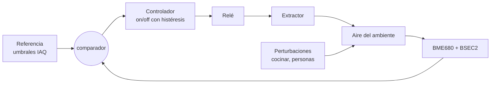

# Mejora propuesta (etapa 2): cerrar el lazo con un extractor

## Idea

Hoy el sistema **mide y avisa**, y el lazo se cierra solo si una persona ventila (ver [conceptos_teoricos.md](conceptos_teoricos.md)). La mejora es agregar un **actuador que actúe sobre el aire**: un **extractor o ventilador** encendido por un **relé**. Así el sistema pasa a ser de **lazo cerrado respecto del ambiente**:



## Hardware sugerido

> ⚠️ Esto agrega componentes nuevos; consultarlo con la cátedra antes de comprar. Si el extractor es de **220 V**, el cableado de potencia lo tiene que hacer o supervisar alguien habilitado. Para el prototipo conviene un **ventilador de 5 V o 12 V** (tipo cooler de PC).

| Componente | Detalle |
|---|---|
| Módulo relé de 1 canal, **optoacoplado**, bobina de 5 V, entrada compatible con 3,3 V | El módulo ya trae el transistor y el diodo de protección. Si usás un relé suelto, agregá transistor NPN + diodo 1N4007 en antiparalelo con la bobina. |
| Ventilador 5 V / 12 V (o extractor con su fuente) | Alimentado **aparte** del ESP32; el relé solo conmuta. |
| Alternativa silenciosa | MOSFET logic-level (ej. IRLZ44N) para un ventilador de CC: permite además variar la velocidad por PWM. |

**Pin sugerido:** **GPIO 13**. Existe en placas de 30 y 38 pines, no es de strapping ni de flash y no está usado en este proyecto. Se agrega en `config.h`:

```cpp
constexpr uint8_t PIN_RELE = 13;  // relé del extractor (HIGH = encendido; revisar si el módulo es activo en bajo)
```

## Ley de control

### Opción A: on/off con histéresis (recomendada)

Es la misma idea que el LED, pero con umbrales propios y **tiempos mínimos** para proteger el motor y el relé:

- **Encender** si IAQ > 150 (`umbralExtractorOn`).
- **Apagar** si IAQ < 100 (`umbralExtractorOff`).
- **Tiempo mínimo encendido:** 3 min, para no cortar antes de renovar el aire.
- **Tiempo mínimo apagado:** 2 min, para no arrancar y parar el motor seguido.
- Con precisión BSEC < 2, **no se enciende** (misma regla que la alarma).

```cpp
// control.h
struct EstadoExtractor { bool encendido = false; uint32_t cambioMs = 0; };
// Devuelve el estado deseado del relé. Pura: se testea en la PC como siguienteLed().
bool extractorPaso(EstadoExtractor& e, float iaq, uint8_t precision, uint32_t ahoraMs, const Config& c);
```

### Opción B: tiempo de encendido "tipo PI"

Con un ciclo fijo de 10 min, el extractor queda encendido una fracción `u` del ciclo:

u = Kp · (IAQ − IAQ_ref) + Ki · Σ(IAQ − IAQ_ref)·Δt, recortado a 0–100 %

Incluir anti-windup: dejar de acumular la integral cuando `u` está saturado. Así el ambiente se mantiene cerca de la referencia con menos arranques que un on/off puro, a cambio de sintonizar Kp y Ki. Los datos exportados (CSV con marcadores) sirven para identificar τ del ambiente y elegir las ganancias.

## Dónde se engancha en el código

| Archivo | Cambio |
|---|---|
| `config.h` | `PIN_RELE`, y en `struct Config` los campos `umbralExtractorOn`, `umbralExtractorOff`, `minEncendidoMin`, `minApagadoMin`. |
| `control.h/.cpp` | `EstadoExtractor` + `extractorPaso()`, y validar los nuevos campos en `validarConfig()`. |
| `tools/test_nativo.cpp` | Tests de `extractorPaso()`: histéresis, tiempos mínimos y el caso sin calibrar. |
| `actuators.h/.cpp` | `pinMode(PIN_RELE, OUTPUT)` en `actuadoresIniciar()` y `digitalWrite` del relé en `actuadoresActualizar()`. |
| `aire_iot.ino` | En `loop()`, junto a `controlPaso()`: `bool rele = extractorPaso(extractor, l.iaq, l.precision, ahora, c);` |
| `web.cpp` | Agregar `"extractor"` al JSON de `/ws` y `/api/current` y los nuevos campos a `/api/config`. |
| `muestras.h/.cpp` | Columna `extractor` en el CSV (muy útil para el dataset: permite ver el efecto del actuador). |
| `web/` | Estado del extractor en el panel "Lazo de control" y los nuevos umbrales en el editor. |

## Qué cambia en la teoría

- El lazo se **cierra físicamente**: el controlador corrige las perturbaciones sin intervención humana. La alarma queda como **respaldo** (por ejemplo, si el extractor no alcanza).
- Aparecen conceptos nuevos para analizar: **tiempo de establecimiento con y sin extractor** (comparar τ en el CSV), **ciclo límite** del on/off (la oscilación del IAQ entre 100 y 150 cuando hay una fuente constante) y **saturación del actuador** (un extractor chico no puede con cualquier perturbación).
